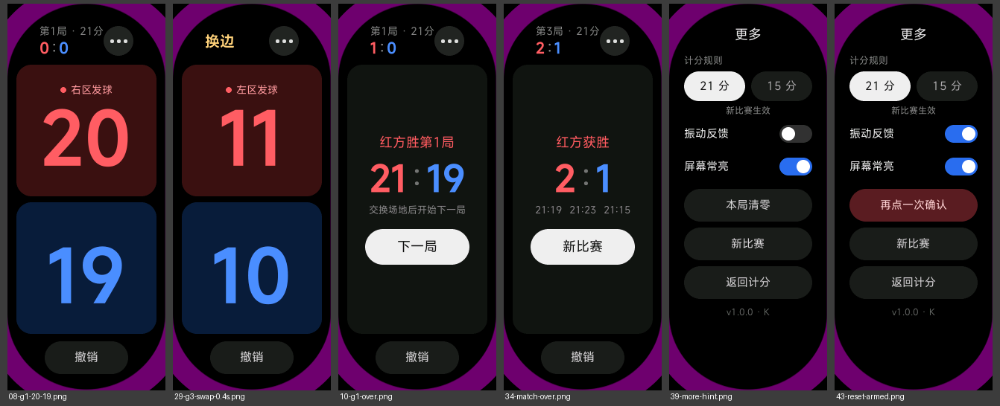

# 羽毛球计分（小米手环10）

装在小米手环10 上的羽毛球计分器（Xiaomi Vela JS 应用）。红蓝两方点击计分，底部撤销；自动提示发球方和发球区；三局两胜，21 分制和 15 分制可选；支持振动反馈和比赛时屏幕常亮；每得一分都存盘，退出后重新打开可以恢复。

## 模拟器效果

模拟器截图：计分页、决胜局换边、局结束、比赛结束、更多页、待确认。截图四角的紫色是模拟器窗口里胶囊形屏幕之外的区域，不是应用画出来的。

## 开发环境

- Node 22（用 nvm 安装）。这台 Mac 的 PATH 里有旧版 npm，执行命令前先运行：
  `export PATH="$HOME/.nvm/versions/node/v22.21.1/bin:$PATH"`
- 安装依赖：`npm install`

## 常用命令

| 命令 | 作用 |
|---|---|
| `npm test` | 运行规则、记录、存储、设备模块的单元测试 |
| `npm run build` | 生成调试包 `dist/com.curain.badminton.debug.<版本>.rpk` |
| `npm run release` | 生成发布包（需要 `sign/` 下的证书，见下文） |
| `npm run icon` | 重新生成应用图标 |
| `npm run emu:create` | 创建手环10 尺寸（212×520）的模拟器，只需一次；本地缺 `vela-watch-5.0` 镜像时会自动下载 |
| `npm run emu:start` | 启动模拟器并保持运行，放在单独一个终端里 |
| `npm run emu:install` | 重新构建并把调试包装进正在运行的模拟器、重启应用，每次改完代码都执行 |
| `npm start` | 官方的 `aiot start --watch`，在这个模拟器镜像上不稳定，见下文，不推荐 |

## 在模拟器里运行

模拟器只用来检查布局和逻辑，振动、常亮、耗电、圆角等仍然要以真机为准。

1. 下载模拟器 SDK（只需一次）：`npx aiot initEmulatorEnv`。它没有选项，下载的是模拟器内核、皮肤等资源和默认的 `vela-miwear-watch-5.0` 镜像，不包含本项目用的 `vela-watch-5.0` 镜像。
2. 创建手环10 尺寸的模拟器（只需一次）：`npm run emu:create`，会得到名为 `Vela_Band10` 的 212×520 模拟器。本地还没有 `vela-watch-5.0` 镜像时，这条命令会先自动下载它（约 210 MB，只下这一个镜像，终端里有进度条）；已经存在同名模拟器时直接跳过，不会覆盖。
3. 在一个单独的终端里运行 `npm run emu:start`，等终端里出现「已启动」一行（`vela-watch-5.0` 镜像不带表盘，窗口里进不到表盘界面是正常的，以这一行为准），这个终端保持开着；在这个终端按 Ctrl+C 会停掉模拟器。
4. 在另一个终端里运行 `npm run emu:install`，它会构建、安装并启动应用，并检查安装结果：输出里没有 `(success 0)` 就报错退出。之后每次改完代码重新执行这条命令即可。

说明与排错：

- **为什么不用 `aiot createVVD`：** 它只有选 miwear 镜像时才会问宽高，选 `vela-watch-5.0` 时固定是 466×466，得不到手环10 的尺寸。`emu:create` 直接调用工具包的接口，参数是 212×520、密度 320、`pill-shaped`、`band`、`arm`。
- **为什么不用 `npm start`：** 它会编译、安装并启动应用，然后因为工具包只等 8 秒，而这个镜像（`vela-watch-5.0`）启动应用要约 10.5 秒，进程报错退出，热更新撑不住。所以改成构建后用工具包自带的 adb 重装。
- **下载卡住或连不上：** 这台网络上 SDK 的下载主机 `vela-ide.cnbj3-fusion.mi-fds.com` 会在 TLS 握手时被断开，`initEmulatorEnv` 会一直转圈。同样的文件在备用主机 `https://cnbj3-fusion.fds.api.xiaomi.com/vela-ide/` 下面，路径和原主机一致，可以手动下载后解压。
  - `vela-watch-5.0` 镜像：`emu:create` 会先探测下载地址，连不上时直接报错并打印下面的步骤。下载 `https://cnbj3-fusion.fds.api.xiaomi.com/vela-ide/system-images/vela-watch-5.0/20250716/vela-watch-5.0.zip`，解压到 `~/.vela/sdk/system-images/vela-watch-5.0/`，使 `nuttx`、`vela_system.bin`、`vela_data.bin`、`coredump.core`、`advancedFeatures.ini` 直接放在这个目录下（不要多套一层文件夹），再重新运行 `npm run emu:create`。
  - `initEmulatorEnv` 的其余部分（模拟器内核 `emulator`、`skins`、`qa`、`modem_simulator`）同理：版本号以 `node_modules/@aiot-toolkit/emulator/lib/emulatorutil/constants.js` 里的 `EmulatorEnvVersion` 为准（备用主机上的 `versions.json` 是旧版，不要参考），解压到 `~/.vela/sdk/<部分名>/`。
- **更多页版本号显示 `v1.0.0 · K`：** 模拟器镜像里没有 `system.brightness`，所以屏幕常亮开关读取失败，错误码 K 是预期现象。真机上不应该出现。

## 安装到手环（AstroBox）

下面的步骤用的是 Mac 版 AstroBox，手机是安卓还是 iPhone 都一样，手机上的小米运动健康只要放开对手环的连接就行。（iPhone 配 Mac 这个组合没有专门的教程，是按「手环同一时间只能连一台主机」推断的，第一次用时留意一下。）

1. 从 https://github.com/AstralSightStudios/AstroBox-NG/releases 下载 Mac 版 AstroBox（Apple Silicon 选 `aarch64.dmg`）。如果 macOS 提示「已损坏，无法打开」（米坛 wiki 说装好后可能需要这一步），去掉隔离属性：`xattr -dr com.apple.quarantine /Applications/AstroBox.app`（路径按实际安装位置改；小米官方文档对 AIoT-IDE 给的也是这个办法）。
2. 在 AstroBox 里手动填入手环的 AuthKey，不要用小米账号登录。第三方工具登录账号容易触发风控，反复要求二次验证；有教程建议关掉小米账号的二次验证来绕过，不要这样做，会降低整个账号的安全。AuthKey 是手环的连接凭据，不要外传，也不要上传到网页，泄露了就要在小米运动健康里解绑再重新绑定。获取方法：
   - 安卓：在小米运动健康的「我的 → 关于」页连点图标约 10 次导出日志，在 `Download/wearablelog` 下的压缩包里找 `encryptKey`。
   - iPhone：在「文件」App 的小米运动健康文件夹里打开 `MHWCahe/<数字id>/VirtualDevice_registerList/manifest.sqlite`（目录名就是这样拼的），搜索 `encrypt_key`。
3. 在手机上彻底关掉小米运动健康（安卓杀掉后台；iPhone 还要在「设置 → 蓝牙」里忽略手环）。
4. 在手环上进入「设置 → 我的设备（老设备叫「系统操作」）→ 连接新手机」，在 AstroBox 里点选手环，然后在手环上确认，并接受系统弹出的配对提示。Mac 上如果报 `RFCOMM channel disconnected`，在系统蓝牙里忘记手环后重新配对。
5. 把 `dist/` 下的 rpk 拖进 AstroBox 窗口，开始安装。
6. 装好后重新打开小米运动健康，让它接管连接。AstroBox 连接前会解除系统层面的蓝牙绑定，有人反映之后要重新设置「手环解锁手机」。

每次重装前都把 `src/manifest.json` 里的 `versionCode` 加 1，包名和签名证书保持不变。

如果手环拒绝安装，先把 `src/manifest.json` 里的 `minPlatformVersion` 从 1200 改成 1000 再试一次，仍然装不上再看下一节的发布包签名。

如果「屏幕常亮」开着，手环还是会息屏，说明手环没有响应应用的常亮请求（设计文档第 7 节第 2 项，待真机确认）。到手环的系统设置里调长息屏时间，或者打开「持续亮屏」（不同固件里的名字可能略有不同）。

更多页版本号后面如果带了错误码，是最近一次出错留下的（零售手环没有调试控制台）：`S1` 读取存储失败，`S2` 写入存储失败，`S3` 存储里的比赛记录损坏或版本不认识、已丢弃并开了新比赛，`V` 振动失败，`K` 屏幕常亮失败。

## 发布包签名（只在调试包装不上时需要）

    mkdir -p sign
    openssl req -newkey rsa:2048 -nodes -keyout sign/private.pem -x509 -days 3650 -out sign/certificate.pem -subj "/CN=badminton"

`sign/` 已在 `.gitignore` 中，私钥要另外备份；以后所有发布包都必须用同一个证书。

注意：`sign/` 一旦存在，调试包也会用它签名。工具包找证书的顺序是：调试包 `sign/debug/` → `sign/` → 工具包自带的默认证书；发布包 `sign/release/` → `sign/`。所以这时调试包的签名证书和之前装机用的不一样，手环可能拒绝升级安装，要先在手环上卸载旧版再装（卸载可能会清掉已保存的比赛）。想让调试包继续用默认证书，可以把证书放进 `sign/release/`，只给发布包用。

## 依赖安全提示

本项目没有运行时依赖，`package.json` 里全部是 devDependencies。`npm audit` 会报出一批漏洞，全部来自 aiot-toolkit 的开发期依赖树，这些包只在你电脑上构建时用，不会进入手环上的应用。不要执行 `npm audit fix --force`，它会把 aiot-toolkit 降级到旧版本，构建会坏。

## 文档

- 可行性调研：`reports/小米手环10 第三方应用开发可行性.md`
- 设计：`docs/superpowers/specs/2026-10-22-badminton-scorer-design.md`
- 真机验收：`docs/real-device-checklist.md`
