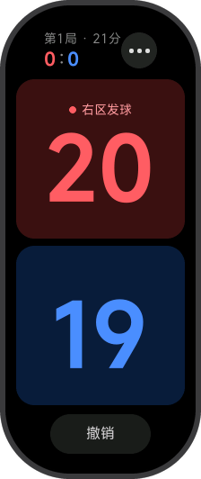
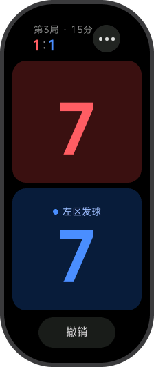
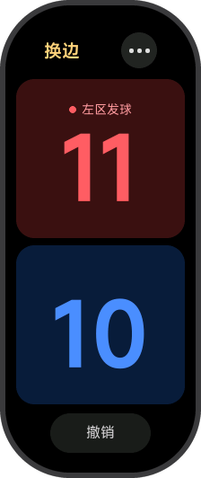
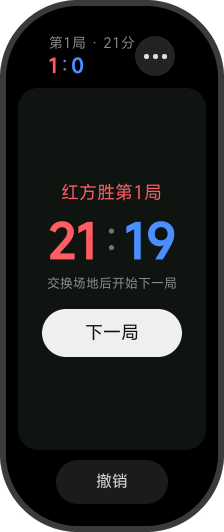
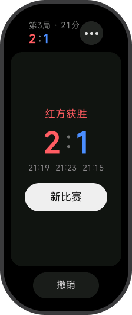
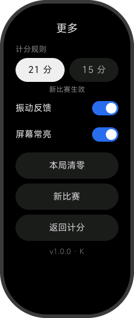
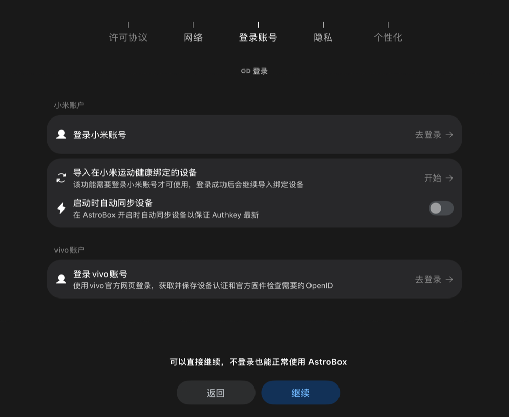
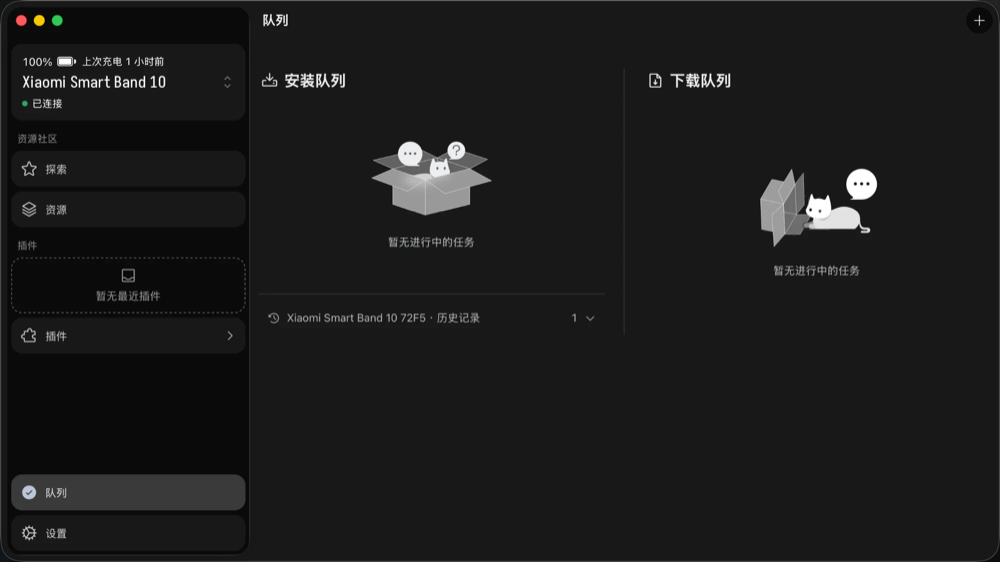

# 羽毛球计分（小米手环10）

装在小米手环10 上的羽毛球比赛计分器，是一个 Xiaomi Vela JS 快应用（`.rpk`）。红蓝两方点一下加一分，底部撤销；自动提示发球方和发球区；三局两胜，21 分制和 15 分制可选；有振动反馈，比赛时可以保持屏幕常亮；每得一分都会存盘，退出后重新打开能接着打。

已在小米手环10 NFC 版（国行，固件 3.1.28）上用 AstroBox 2.2.0 安装成功。

> 这是个人项目，和小米公司无关。小米没有给个人开发者开放装机渠道，下文的安装方法用第三方工具 AstroBox 侧载，风险自负。
>
> 非商业使用免费，商业使用需要另外取得授权，见文末「[许可证](#许可证)」。

## 效果

| 计分 | 15 分制 | 决胜局换边 |
|:---:|:---:|:---:|
|  |  |  |
| 红蓝两张卡片，点哪边哪边加分；小字提示发球方和发球区 | 第 3 局 7:7，蓝方在左区发球 | 决胜局有一方先到 11 分时提示换边 |
| **一局结束** | **比赛结束** | **更多** |
|  |  |  |
| 红方 21:19 拿下第 1 局，点「下一局」继续 | 红方 2:1 获胜，列出每局比分 | 切换赛制、振动和常亮，本局清零或开新比赛 |

截图来自和手环10 同尺寸（212×520）的模拟器。模拟器没有屏幕常亮接口，所以更多页版本号后面带了错误码 `K`；真机上屏幕常亮正常时不会出现。

## 功能

- 点红色或蓝色区域给这一方加一分；底部「撤销」退回上一分，可以跨局撤销
- 显示第几局、局分、比分，以及发球方和发球区（右区 / 左区）
- 三局两胜。21 分制：先到 21 分且领先 2 分，30 分封顶；15 分制：先到 15 分且领先 2 分，21 分封顶
- 决胜局有一方先到 11 分（15 分制是 8 分）时提示换边
- 一局结束、比赛结束时显示结果
- 振动反馈：得分和撤销短震一下，一局结束长震，比赛结束长震两次，换边短震两次
- 比赛时保持屏幕常亮（可以关）
- 每一分都自动保存，退出或重启后恢复比赛进度
- 全部操作靠点击，不用输入文字，也不用设队名

## 使用

- **计分：** 点红色或蓝色卡片，这一方加一分。卡片上的小字提示谁发球、在哪个区发球。
- **撤销：** 点底部「撤销」，退回上一分。
- **一局结束：** 显示这一局的比分，点「下一局」继续。结束后约 1 秒内的点击会被忽略，防止手快误点。
- **比赛结束：** 显示每局比分，点「新比赛」重新开始。
- **更多：** 点右上角的三个点进入更多页：
  - 计分规则：21 分或 15 分，从下一场新比赛开始生效（当前比赛还没得分时立即生效）
  - 振动反馈、屏幕常亮的开关
  - 本局清零、新比赛：要点两次才会执行，防止误触
  - 返回计分
- **退出：** 在计分页右滑一次会提示「再滑一次退出」，2 秒内再滑一次退出。进度已经自动保存。

## 安装到手环

需要准备：

- 小米手环10。我用的是 NFC 版国行，手机是安卓，装的小米运动健康。
- 一台有蓝牙的电脑。下面以 Mac 为例；AstroBox 也有 Windows、Linux 和安卓版本，步骤类似，我没有测过。
- 安装包 `.rpk`：按下文「从源码构建」生成，在 `dist/` 目录下。

### 1. 安装 AstroBox

从 [AstroBox-NG 的 Releases 页面](https://github.com/AstralSightStudios/AstroBox-NG/releases) 下载 Mac 版：Apple 芯片选 `aarch64.dmg`，Intel 芯片选 `x64.dmg`。我用的是 2.2.0。

如果打开时提示「已损坏，无法打开」，在终端去掉隔离属性后再打开：

```bash
xattr -dr com.apple.quarantine /Applications/AstroBox.app
```

### 2. 取出手环的 AuthKey

AuthKey 是手环的连接凭据，AstroBox 靠它连接手环。

- **安卓：** 在小米运动健康的「我的 → 关于」页连点图标约 10 次导出日志，在手机的 `Download/wearablelog` 下找到压缩包，解压后搜 `encryptKey`，后面那串 32 位的十六进制字符就是。日志里还有一个 `authKey` 字段，是空的，不要用它。
- **iPhone：** 在「文件」App 的小米运动健康文件夹里打开 `MHWCahe/<数字id>/VirtualDevice_registerList/manifest.sqlite`（目录名就是这么拼的），搜 `encrypt_key`。

注意：

- AuthKey 不要截图公开、发给别人或贴到网页上。万一泄露，在小米运动健康里解绑手环再重新绑定，旧的就作废了。
- 导出的日志里还有账号令牌等其他凭据，取完 AuthKey 就把日志删掉。
- 想留着以后用，可以存进项目根目录的 `astrobox-authkey.txt`（已在 `.gitignore` 里，不会进仓库），要用时运行 `pbcopy < astrobox-authkey.txt` 复制到剪贴板。

### 3. 第一次打开 AstroBox：不用登录

AstroBox 第一次打开会引导你登录小米账号，直接点「继续」跳过，不登录也能正常使用。第三方工具登录小米账号容易触发风控、反复要求验证；有教程建议关掉小米账号的二次验证来绕过，不要这样做，会降低整个账号的安全。「启动时自动同步设备」和 vivo 账号也都不用管。



### 4. 让手机放开手环

手环同一时间只能连一台设备。手机还连着时，AstroBox 搜不到手环，或者连上马上又断开。任选一种办法：

- **关掉手机蓝牙（最省事）：** 装完再打开。
- **强行停止小米运动健康：** 安卓在「设置 → 应用 → 小米运动健康」里点「强行停止」，只从最近任务里划掉不够；iPhone 还要在「设置 → 蓝牙」里忽略手环。

不要在小米运动健康里解除绑定，解绑会让刚取出的 AuthKey 作废。

### 5. 连接手环

1. 在手环上进入「设置 → 我的设备 → 连接新手机」（较早的固件叫「系统操作」），点右下角蓝色的勾，停在等待连接的界面。
2. 在 AstroBox 里点左上角的设备卡片打开设备列表，点「添加新设备」右边的「刷新」。
3. 列表里会出现 `Xiaomi Smart Band 10 xxxx`，点它。列表里的其他名字是附近别的蓝牙设备，不用管。AstroBox 没有单独填 AuthKey 的入口，点了手环之后才会弹出输入框。
4. 填入 AuthKey，点「连接」。
5. 手环震一下，点手环上蓝色的勾；电脑弹出配对提示时点「绑定」或「连接」。

Mac 上如果报 `RFCOMM channel disconnected`，到 Mac 的蓝牙设置里忽略手环，从第 1 步重来。

### 6. 安装

把 `.rpk` 拖进 AstroBox 窗口。装好后，安装队列下面的历史记录多一条，手环的应用列表里出现「羽毛球计分」（上红下蓝的圆形图标，中间一个白色羽毛球）。



### 7. 把手环还给手机

打开手机蓝牙，再打开小米运动健康，让它重新连上手环。计分器装在手环本地，使用时不需要连着 AstroBox。AstroBox 连接时会解除系统层面的蓝牙绑定，有人反映之后要重新设置「手环解锁手机」。

### 装不上或用起来不对

- **手环拒绝安装：** 把 `src/manifest.json` 的 `minPlatformVersion` 从 1200 改成 1000，重新构建再试；还不行就换用发布包，见下文「发布包签名」。
- **升级安装：** 每次重装前把 `src/manifest.json` 的 `versionCode` 加 1，包名和签名证书保持不变。
- **屏幕常亮不生效：** 说明手环没响应应用的常亮请求。可以在手环的系统设置里调长息屏时间（最长 5 分钟），或者打开「持续亮屏」（不同固件里名字可能不同；小米提示开启后耗电会明显增加）。
- **更多页版本号后面带了字母：** 这是最近一次出错留下的错误码（零售手环上没有调试控制台）：

| 错误码 | 含义 |
|---|---|
| `S1` | 读取存储失败 |
| `S2` | 写入存储失败 |
| `S3` | 存储里的比赛记录损坏或版本不认识，已丢弃。启动时会开新比赛；从更多页返回时保留屏幕上的比赛 |
| `V` | 振动失败 |
| `K` | 屏幕常亮失败（模拟器上一定会出现） |

真机上还有一些细节（振动手感、常亮耗电、右滑退出等）在逐项确认，记录在 [真机验收清单](docs/real-device-checklist.md)。

## 从源码构建

需要 Node 22 或更新版本。如果 `npm -v` 显示的版本很旧（比如 PATH 里还有另一份旧的 npm），先切到 Node 22 自带的 npm 再运行下面的命令。

```bash
npm install
npm test
npm run build
```

`npm run build` 生成调试包 `dist/com.curain.badminton.debug.<版本>.rpk`，拿它按上文安装即可。

| 命令 | 作用 |
|---|---|
| `npm test` | 运行规则、记录、存储、设备模块的单元测试 |
| `npm run build` | 生成调试包 |
| `npm run release` | 生成发布包（需要 `sign/release/` 下的证书，见下文） |
| `npm run icon` | 重新生成应用图标 |
| `npm run emu:create` | 创建手环10 尺寸（212×520）的模拟器，只需一次；本地缺 `vela-watch-5.0` 镜像时会自动下载 |
| `npm run emu:start` | 启动模拟器并保持运行，放在单独一个终端里 |
| `npm run emu:install` | 重新构建，把调试包装进正在运行的模拟器并重启应用；每次改完代码都执行 |
| `npm start` | 官方的 `aiot start --watch`，在这个模拟器镜像上不稳定，见下文，不推荐 |

### 发布包签名（只在调试包装不上时需要）

```bash
mkdir -p sign/release
openssl req -newkey rsa:2048 -nodes -keyout sign/release/private.pem -x509 -days 3650 -out sign/release/certificate.pem -subj "/CN=badminton"
```

`sign/` 已在 `.gitignore` 中，私钥要另外备份；以后所有发布包都必须用同一个证书。

证书放在 `sign/release/`，只给发布包用，调试包继续用工具包自带的默认证书。不要直接放在 `sign/` 下：工具包找证书的顺序是，调试包 `sign/debug/` → `sign/` → 工具包自带的默认证书，发布包 `sign/release/` → `sign/`。放在 `sign/` 下的话，调试包也会改用它签名，和之前装机用的证书不一样，手环可能拒绝升级安装，要先在手环上卸载旧版再装（卸载可能会清掉已保存的比赛）。

### 在模拟器里运行

模拟器只用来检查布局和逻辑，振动、常亮、耗电、圆角等仍然要以真机为准。

1. 下载模拟器 SDK（只需一次）：`npx aiot initEmulatorEnv`。它没有选项，下载的是模拟器内核、皮肤等资源和默认的 `vela-miwear-watch-5.0` 镜像，不包含本项目用的 `vela-watch-5.0` 镜像。SDK 放在 `~/.vela/sdk`，约 3.4 GB。
2. 创建手环10 尺寸的模拟器（只需一次）：`npm run emu:create`，会得到名为 `Vela_Band10` 的 212×520 模拟器。本地还没有 `vela-watch-5.0` 镜像时，这条命令会先自动下载它（约 210 MB，终端里有进度条）；已经有同名模拟器时直接跳过，不会覆盖。
3. 在一个单独的终端里运行 `npm run emu:start`，等终端里出现「已启动」一行。`vela-watch-5.0` 镜像不带表盘，窗口里进不到表盘界面是正常的，以这一行为准。这个终端保持开着，按 Ctrl+C 会停掉模拟器。
4. 在另一个终端里运行 `npm run emu:install`，它会构建、安装并启动应用，并检查安装结果：输出里没有 `(success 0)` 就报错退出。之后每次改完代码重新执行这条命令即可。

说明与排错：

- **为什么不用 `aiot createVVD`：** 它只有选 miwear 镜像时才会问宽高，选 `vela-watch-5.0` 时固定是 466×466，得不到手环10 的尺寸。`emu:create` 直接调用工具包的接口，参数是 212×520、密度 320、`pill-shaped`、`band`、`arm`。
- **为什么不用 `npm start`：** 它会编译、安装并启动应用，但工具包只等 8 秒，而这个镜像启动应用要约 10.5 秒，进程报错退出，热更新用不了。所以改成构建后用工具包自带的 adb 重装。
- **下载卡住或连不上：** 在部分网络下，SDK 的下载主机 `vela-ide.cnbj3-fusion.mi-fds.com` 会在 TLS 握手时被断开，`initEmulatorEnv` 会一直转圈。同样的文件在备用主机 `https://cnbj3-fusion.fds.api.xiaomi.com/vela-ide/` 下面，路径和原主机一致，可以手动下载后解压。
  - `vela-watch-5.0` 镜像：`emu:create` 会先探测下载地址，连不上时直接报错并打印下面的步骤。下载 `https://cnbj3-fusion.fds.api.xiaomi.com/vela-ide/system-images/vela-watch-5.0/20250716/vela-watch-5.0.zip`，解压到 `~/.vela/sdk/system-images/vela-watch-5.0/`，使 `nuttx`、`vela_system.bin`、`vela_data.bin`、`coredump.core`、`advancedFeatures.ini` 直接放在这个目录下（不要多套一层文件夹），再重新运行 `npm run emu:create`。
  - `initEmulatorEnv` 的其余部分（模拟器内核 `emulator`、`skins`、`qa`、`modem_simulator`）同理：版本号以 `node_modules/@aiot-toolkit/emulator/lib/emulatorutil/constants.js` 里的 `EmulatorEnvVersion` 为准（备用主机上的 `versions.json` 是旧版，不要参考），解压到 `~/.vela/sdk/<部分名>/`。
- **更多页版本号显示 `v1.0.0 · K`：** 模拟器镜像里没有 `system.brightness`，屏幕常亮开关调用失败，错误码 K 是预期现象。

### 依赖安全提示

本项目没有运行时依赖，`package.json` 里全部是 devDependencies。`npm audit` 会报出一批漏洞，全部来自 aiot-toolkit 的开发期依赖树，这些包只在电脑上构建时用，不会进入手环上的应用。不要执行 `npm audit fix --force`，它会把 aiot-toolkit 降级到旧版本，构建会坏。

## 项目结构

```
src/
  manifest.json      应用清单（包名、权限、页面）
  pages/score/       计分页
  pages/more/        更多页
  common/rules.js    比赛规则：从得分顺序推出比分、局分、发球方
  common/match.js    比赛记录的加分、撤销、下一局、清零
  common/store.js    存储读写和设置
  common/device.js   振动和屏幕常亮
test/                单元测试（Node 自带的测试框架）
tools/               图标生成脚本、模拟器脚本
docs/                设计文档、实施计划、真机验收清单、截图
```

## 文档

- 可行性调研：[reports/小米手环10 第三方应用开发可行性.md](reports/小米手环10%20第三方应用开发可行性.md)
- 设计：[docs/superpowers/specs/2026-10-22-badminton-scorer-design.md](docs/superpowers/specs/2026-10-22-badminton-scorer-design.md)
- 实施计划：[docs/superpowers/plans/2026-10-22-badminton-scorer.md](docs/superpowers/plans/2026-10-22-badminton-scorer.md)
- 真机验收：[docs/real-device-checklist.md](docs/real-device-checklist.md)

## 许可证

本项目采用 [PolyForm Noncommercial License 1.0.0](LICENSE.md)（非商业许可证）。

- **可以免费使用：** 个人学习、研究、自用、业余爱好，以及学校、公益组织、科研机构、政府机构使用。可以修改，也可以转发，但要附上许可证全文和 [LICENSE.md](LICENSE.md) 开头的 `Required Notice` 两行。
- **商业用途需要授权：** 比如拿来做收费产品、集成进商业应用、在公司业务中使用，都不在免费授权范围内。需要商业授权请通过 [Issues](https://github.com/curaiNn/badminton-scorer-for-XiaomiBand10/issues) 联系作者，商业授权收费。
- 软件按原样提供，不提供任何担保。

以上是中文说明，具体条款以 [LICENSE.md](LICENSE.md) 的英文原文为准。
